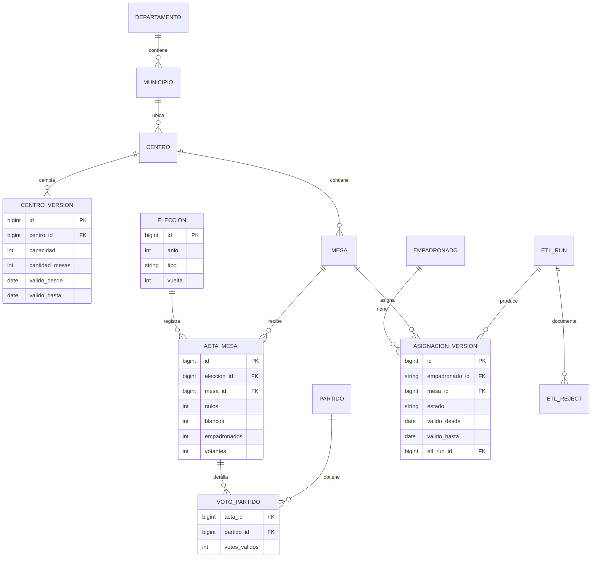

# Análisis crítico del modelo

El DDL original se conserva. Estas propuestas son una evolución separada y no son necesarias para ejecutar el ETL entregado.

## Problemas por impacto

| Prioridad | Problema | Consecuencia concreta | Propuesta / costo |
|---|---|---|---|
| 1 | No hay unicidad natural en centros, mesas o resultados ni FK | El ETL tiene que evitar duplicados con bloqueos y verificar relaciones. Una carga externa puede introducir huérfanos. | UNIQUE para códigos/grano, NOT NULL y FK después de sanear; crear índices sin bloquear y validar restricciones gradualmente. |
| 2 | Totales de mesa repetidos por partido | SUM(total_votantes_mesa) multiplica la participación. Un mismo total puede contradecirse entre filas. | Separar acta/mesa electoral de votos por partido; migración con conciliación previa. |
| 3 | Números y fechas como varchar | Comparaciones lexicográficas, casts fallidos y consultas costosas. | integer para votos/capacidad, numeric para coordenadas, date para fechas, timestamptz para auditoría. Sanear antes de convertir. |
| 4 | Padrón sobrescrito | Se pierde dónde votaba una persona, cuándo fue trasladada y su estado anterior. No se puede reconstruir cobertura histórica. | Versionar asignación/estado con vigencia desde/hasta y conservar snapshots de origen. Aumenta almacenamiento y complejidad temporal. |
| 5 | Catálogos y nombres geográficos redundantes | Variantes de nombre fragmentan agrupaciones y permiten municipio/departamento contradictorios. | Departamento, municipio, centro, partido y elección con claves referenciales. Conservar código y nombre oficial. |
| 6 | carga_log libre y corta, fecha textual | Difícil consultar fallos, vincular una fila a un archivo y calcular estadísticas operativas. | etl_run con estado, checksum, corte, inicio/fin, métricas y watermark; etl_reject con motivo y referencia al original. |
| 7 | Falta de índices para consumo | Barridos y casts en filtros de elección, municipio y estado. | Índices por patrones reales: acta(eleccion,mesa), mesa(centro), asignacion(estado,vigencia), municipio(departamento). Medir con EXPLAIN antes de agregar más. |

## Modelo propuesto

Un núcleo normalizado mantiene la integridad. Vistas de consumo presentan métricas al dashboard sin repetir lógica. Un almacén dimensional podría añadirse después si el volumen y las consultas lo justifican.

Restricciones propuestas: elección única por año/tipo/vuelta; acta única por elección/mesa; voto único por acta/partido; votos no negativos y votantes <= empadronados. La conciliación entre partidos es una regla de conjunto y requiere validación transaccional, no un CHECK aislado de fila. Versiones de asignación de una persona no deben solaparse y solo puede haber una vigente. Códigos siguen siendo texto para preservar ceros.

## Historización

Al cambiar la mesa o el estado se cierra la versión anterior y se abre una nueva (SCD tipo 2). Un cambio en capacidad o ubicación del centro genera una versión del centro. Así se puede responder cuántas personas estaban asignadas a un centro en una fecha, qué traslados recibió y qué capacidad tenía entonces. Los tres snapshots permiten reconstruir desde marzo de 2026; no inventan el historial anterior. Debe distinguirse vigencia del negocio de momento de recepción; una corrección tardía puede requerir tiempo bitemporal.

## Migración gradual

1. Perfilar y conciliar duplicados, huérfanos y discrepancias con el proveedor; no crear restricciones sobre datos aún contradictorios.
2. Crear tablas nuevas en un esquema separado y cargar un snapshot consistente, guardando correspondencias de IDs.
3. Reconstruir las versiones que permiten los archivos existentes y validar conteos, totales y consultas de muestra.
4. Capturar cambios posteriores y comparar el consumo antiguo y nuevo en paralelo.
5. Publicar vistas compatibles y cambiar el consumidor después de revisar resultados. Mantener el esquema antiguo de solo lectura durante una ventana de reversión.
6. Retirar estructuras antiguas cuando se complete la aceptación. La reversión cambia las vistas; no depende de borrar datos.
