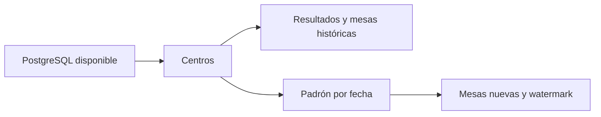

# Orquestación implementada

Prefect 3.9.1 coordina los flujos de orchestration/flows.py. Ofrece estados visibles, tareas con reintentos y programación por zona horaria. Airflow añade infraestructura para este alcance; cron requiere implementar seguimiento adicional. El CLI del ETL funciona sin Prefect.

## Dependencias



Histórico manual: primero centros y después resultados. Cada fuente confirma por separado; si resultados falla, reejecutar es seguro. Padrón requiere centros cargados; no necesita votos históricos. Mesas también se derivan del padrón.

Diario a las 02:00 America/Guatemala, configurable en config.yaml. Sin fecha explícita descubre archivos pendientes hasta hoy y los procesa en orden según watermark. Si no hay archivos nuevos, falla con alerta para revisar su llegada. Al ser snapshots no se exige continuidad para actualizar el estado vigente, pero una fecha omitida no puede reconstruirse sin su fuente.

## Reintentos y fallos

Tres reintentos, 30 segundos entre intentos, para errores transitorios de conexión, deadlock o serialización. La preparación inicial de catálogo y watermark también es una tarea reintentable. No reintentar automáticamente CSV inválido, catálogo faltante o fechas antiguas. El siguiente día no se procesa si el anterior falla.

Datos, mesas y watermark se confirman juntos por fecha. Un fallo revierte ese día; las fechas previas permanecen. Los intentos conservan evidencia local incluso tras rollback. Un bloqueo global serializa nuestros flujos; el merge bloquea la tabla durante la comparación frente a otros escritores.

Prefect muestra fallo y el hook escribe ALERTA en stderr. Si ALERT_WEBHOOK_URL está configurada en el entorno, envía JSON con flujo, ejecución, estado y mensaje. Sin ese destino no hay entrega externa. Las advertencias electorales se registran en reportes y no equivalen a fallo técnico.

## Ejecución Docker

```powershell
docker compose --profile orchestration up -d --build prefect-server scheduler
# Abrir http://localhost:4200
docker compose run --rm --entrypoint python scheduler -m orchestration.flows historico
docker compose run --rm --entrypoint python scheduler -m orchestration.flows daily 2026-03-04
```

El servidor conserva metadatos en un volumen SQLite para esta demostración. El scheduler registra los deployments y ejecuta los flujos en procesos locales. Si el servidor aún arranca, scheduler reinicia ante fallo. Producción requiere almacenamiento de metadatos robusto, autenticación, retención y respaldos.

Opción local (Python >=3.11,<3.16 para Prefect; se recomienda 3.12):

```powershell
.\.venv\Scripts\python.exe -m pip install -r requirements-orchestration.txt
.\.venv\Scripts\prefect.exe server start
# En otra terminal:
$env:PREFECT_API_URL='http://127.0.0.1:4200/api'
.\.venv\Scripts\python.exe -m orchestration.flows serve
```

## Backfill

```powershell
# Sobre base nueva, después del histórico:
docker compose run --rm etl backfill --desde 2026-03-02 --hasta 2026-03-04
# Reproceso del estado actual:
docker compose run --rm etl load-empadronados --fecha 2026-03-04
```

Con Prefect ejecutar daily para fechas nuevas en orden. Para corregir un archivo antiguo usar `docker compose run --rm etl rebuild-padron --hasta 2026-03-04`, con el corte vigente o uno posterior. Se reconstruyen todos los snapshots desde el inicio en tabla temporal y se publica el resultado en una sola transacción; cualquier fallo conserva el estado anterior. No cambia los CSV, conserva created_at existente y exige snapshots diarios completos. El deployment manual electoral-reconstruccion/reconstruir recibe hasta; también se ejecuta con `docker compose run --rm --entrypoint python scheduler -m orchestration.flows rebuild 2026-03-04`.
